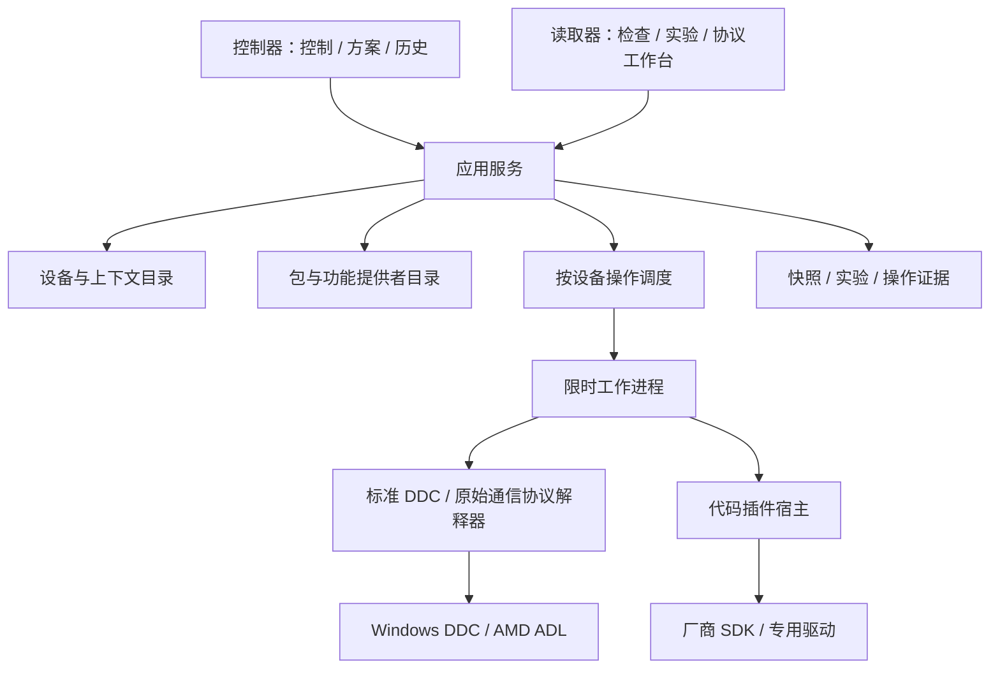

# DisplayControlLab 产品、交互与重构规格

日期：2026-10-11。状态：已进入本地重构预览，实际验收与硬件边界见 PRODUCT_VALIDATION.md。本文件替代上一轮仅按代码模块划分的重构计划，是本次实现和验收的唯一设计入口。已有预览属于技术验证版，不代表本规格已经完成。

## 1. 产品目的与边界

让普通用户方便地控制自己的显示器，让协议作者能独立制作、验证和分享设备支持。

保留两个工具入口：控制器负责日常操作，读取器负责检查、记录、比较与适配研究。两者共享设备目录、已安装包、操作服务和会话资料。读取器可以独立安装、选择适配包，不依赖先打开控制器。

普通使用者不需要理解 VCP、报文或 JSON；协议作者需要可视化编辑和证据工具，源码和原始报文放在高级视图。协议文件和代码插件都由用户按需安装，主程序不打包全部型号协议。

支持范围由设备实际能力决定。没有通用自动发现未知私有协议的承诺，没有厂商封闭 SDK 可任意调用的承诺。默认不恢复出厂、不自动切输入或断电，不为测试自动切换 Windows HDR。

## 2. 当前产品不达标的代码证据

| 证据位置 | 目前行为 | 产品缺口 |
|---|---|---|
| src/Core/DeviceControl.cs / Standard | 固定五个数字功能 | 不是按设备发现的能力目录，无法表达更多标准/私有功能 |
| src/Controller/MainWindow.xaml | 功能下拉、可编辑值下拉和 JSON 结果框 | 日常调亮度要依次选择/读取/输入，不直观；失败没有按功能定位 |
| src/Controller/MainWindow.xaml.cs / ControlChanged、ShowDevice | 切换功能或设备清空 reading、restoreValue | 恢复入口是短暂内存值，不是操作历史与可核查恢复 |
| src/Core/DeviceControl.cs / ProcessClient.Run | 成功必须含 current/maximum 且 current<=maximum | 插件接口绑定数字滑块，不能正确表达动作、只写项或枚举 |
| src/Core/Packages.cs / PackageState.Bindings | 一个连接绑定一个包 id | 无法同时启用互补包，无逐功能冲突解析和版本固定 |
| src/Controller/MainWindow.xaml.cs / NewClick、ValidateClick | 序列化模板到文本框，校验 JSON | 缺少字段编辑、规则预览、回包回放和实机验证工作流 |
| src/Reader/ReadSession.cs / Observe | 主要比较成功的 Current 值，基线在内存 | 没有快照管理、状态/范围变化对比、重开会话和分段分析 |
| src/Reader/MainWindow.xaml | 一次读取、连续记录、A/B 标记、原始表格 | 没有解释用户该完成什么、采样是否覆盖切换、下一步如何生成适配成果 |

这些底层组件有局部验证价值；上述缺口不能由“编译和测试通过”抵消。新的产品验收必须使用完整任务，而不是按钮数量。

## 3. 角色与完成结果

| 角色 | 任务 | 完成结果 |
|---|---|---|
| 日常用户 | 调节亮度、切模式、保存办公/游戏方案 | 屏幕状态已改变并反馈，方案可重复应用 |
| 排查用户 | 不知道某项为何不可用 | 得到当前能力、失败原因和明确下一步，而非一份原始 JSON |
| 研究用户 | 手动切菜单，比较前后发生了什么 | 会话、快照、差异表与可分享证据，保留不确定性 |
| 协议作者 | 把已知指令做成别人可用的适配 | 可编辑草稿、条件规则、验证报告和独立安装包 |
| 插件作者 | 接入专用驱动 | 稳定接口、模拟宿主、依赖诊断和完整打包验证 |

## 4. 信息架构与页面职责

两个入口使用相同的设备侧栏。每台设备显示用户昵称、系统编号、型号、连接/离线状态和适配状态。选中设备后所有页面绑定同一设备上下文。不要用型号字符串当唯一身份。

控制器导航：显示器控制、我的方案、操作历史、适配包、设置。读取器导航：设备检查、快照比较、实验记录、协议工作台、适配包、设置。相同的适配包/设置页复用组件和服务。

### 控制器首页布局

```text
设备侧栏             当前显示器：书桌主屏 / Q27G4ZMN          [刷新状态]
书桌主屏             连接正常 · Windows HDR 关闭 · AOC 包启用
副屏
                     常用
                     亮度       [——●————] 85 / 100     [应用]
                     对比度     [———●———] 50 / 100     [应用]
                     显示器 HDR [关闭 | 图片 | 电影 | 游戏]

                     颜色 / 声音 / 输入与电源 / 厂商功能    [展开]
                     不可用功能（2） [查看原因]

                     我的方案 [办公] [游戏] [+ 保存当前状态]
                     最近操作：HDR 游戏→关闭，已回读确认 [查看详情]
```

数字：滑块加数值框，显示真实范围/单位，不假设都是百分比。拖动只改变待应用值，松手不连发几十条硬件命令；默认交互按第 18 节采用结束调节后节流提交，并可切换手动应用。枚举用模式选项，开关用开关，动作用按钮，文本状态只读。未知原始值显示“未识别值”，仍保留数字，不冒充某模式。

普通成功反馈就在控件旁。详细返回、原生状态和报文折叠在操作详情，不占首页。每个控件分别显示读取中、当前值、待应用、应用中、成功、无法确认、失败及更新时间。

### 读取器首页布局

```text
设备侧栏             设备检查
                     连接 / Windows HDR / 当前适配 / 查询耗时
                     [检查已知功能] [保存快照] [比较两个快照]

                     功能      当前状态   来源   可读/可写声明  本次结果
                     亮度      85         标准   可读写        读取成功
                     HDR预设   关闭       AOC包  可读写        读取成功

                     想分析菜单切换？[新建实验记录]
                     有已知指令？    [创建协议草稿]
```

“检查已知功能”只读支持目录中的已知请求。普通功能读取失败不自动启动全码扫描。扩展 GET 是高级诊断任务，有范围、预计耗时与取消，不能显示为“自动抓取私有协议”。

## 5. 四条必须贯通的用户流程

### F1：首次运行到第一次控制

1. 枚举设备并读取基础身份，不写硬件；没有设备时展示连接/远程会话排查，不出现空的功能下拉框。
2. 选中设备，逐项检查内置已知能力；先返回的结果先显示。成功、失败、设备声明和包声明分别显示。
3. 没有私有包仍能使用标准功能。私有区域提示“尚无适配包”，提供导入入口，不引导普通用户写 JSON。
4. 导入包后展示适用设备、新增/覆盖功能、依赖和代码执行说明。选定应用范围后刷新能力。
5. 调整功能，执行前再次验证连接和条件；应用后控件显示回读结果。不能要求用户为每次调节重新手动点读取。
6. 用户关闭/重开软件，昵称、适配选择和操作历史保留，旧值带时间显示，不能当新读取成功。

### F2：保存、应用和恢复日常方案

1. “保存当前状态”只收录实际读取成功、用户勾选的可设置功能；名称如“办公”“游戏”，支持编辑、复制、导入/导出与删除。
2. 方案保存语义值（如 hdr-preset=game），不保存恰巧是 3 的数字；记录功能提供者、包版本和条件要求。
3. 应用前展示设备、将改变的项、当前条件下不可用的项。默认严格执行：缺少必需项就不开始；用户可明确选择跳过可选项。
4. 先预检全部必需项；按依赖顺序逐项应用并回读。一项失败默认停止后续，显示部分成功清单；不是假装硬件支持事务。
5. 操作历史提供“恢复本次已修改项”。先读现在的状态、检查设备/提供者/条件；如果用户已经改过其中一项，显示冲突让用户选择，不盲目覆盖。
6. 联动设置必须有明确覆盖范围。HDR 涉及颜色增益时，若包未定义/采集这些项，提示只恢复 HDR 预设，不宣称整个显示器恢复。

首版包含单设备方案。跨设备批量方案、定时切换和按程序自动切换留到后续，不能让它们阻塞基本闭环。

### F3：手动切菜单到有用的实验结论

1. 新建实验：选设备，填写问题（例如“OSD HDR 游戏开关”），选择采样功能范围；默认已知功能，可另外选择扩展 GET。
2. 预览首轮耗时；建立基线段。用户看到“基线已采到 2 轮”，而不是猜测是否已经开始。
3. “准备切换”暂停发起新轮次并等待当前轮完成；界面提示可以操作菜单。用户完成后点“开始采集此状态”，给状态段命名。
4. 自由连续记录仍可用；标记可以后改名称和边界。跨越切换边界的一轮标为过渡数据，不用于稳定段比较。标记不是硬件事实。
5. 稳定段完成后可以再切回原状态，形成 A→B→A。可选无操作对照段。不会要求固定等 20 秒而忽略实际采样耗时。
6. 停止后展示结构化比较：当前值、类型/范围、可用状态、新出现/消失项、失败数、系统状态和包版本。失败不等于 0，也不把旧有效值放进新样本冒充成功。
7. 输出结论层级：“有变化”“重复关联”“语义待确认”“无有效数据”；候选按有效轮数和一致性列证据。颜色联动不能自动命名成 HDR。
8. 可关闭并重新打开会话、编辑标记、选择任意两段重新比较，导出包含原始样本的证据包供 AI 或其他作者分析。
9. 用户已有指令时从证据进入“创建协议草稿”；没有指令时只导出线索，明确 GET 扫描不能生成未知私有报文。

### F4：已知协议到别人可安装的适配包

1. 新建选择：标准功能映射、私有报文协议、代码插件项目。已有设备信息自动填入，可由作者限定适用范围。
2. 编辑基本信息、匹配条件、依赖、功能类型/读写能力、报文/解析及条件映射。JSON 是高级视图，与表单使用同一文档模型，可双向切换且不丢字段。
3. 导入真实回包或人工样例，离线预览解析、模式显示及条件命中。错误定位到具体功能/字段，未验证项不显示“已支持”。
4. “测试读取”由用户主动触发，绑定当前设备和草稿版本，不需要先安装草稿。
5. “测试写入”单独进入测试流程：目标值、前置条件、原值、预计受影响项、回读方式及恢复方式。无读取能力的项明确不能保存原值；不是一律拒绝插件只写能力。
6. 生成验证报告：设备/连接、系统上下文、包内容哈希、读写前后、原始证据、恢复结果、用户对屏幕效果的确认。作者声明和本机测试结果分别显示。
7. 发布到本地包（不自动上传）。自己安装或导出分享。格式校验通过不自动表示所有设备验证通过。

## 6. 功能能力模型

功能至少包含：稳定 id、语义类型、类别、显示名、值类型、单位、范围或选项、读/写/执行能力、当前条件、不可用原因、提供者及验证方式。

值类型：数值（min/max/step）、枚举（稳定 option id 与显示名）、布尔、只读文本/结构状态、无返回值动作。动作没有 maximum；枚举数字编码可大于显示器报告的 maximum，不按数字滑块的规则统一判断，而由协议映射约束。

能力状态分为：未知、可读取、只写/可执行、条件不满足、后端缺失、读取失败、提供者冲突。读成功不能证明写入效果；包声明可写与本机写入验证分开。

标准功能目录覆盖亮度、对比度、色温、RGB、音量、静音、输入源及电源状态。每项都有固定标准语义及取值解释，未能验证的设备选项不乱猜。输入切换与断电归入独立组，操作前说明可能失去回读；不强制所有功能可回读。

Windows HDR 开关是系统功能；显示器 HDR 预设是设备功能，分组/文案明确区别。先做状态识别与设备预设控制，不把未知的系统写 API 纳入首版。

AOC 规则案例：语义 game 在 Windows HDR=false、私有范围=3 时编码 3；Windows HDR=true、私有范围=4 时编码 4。未知/矛盾条件拒绝写入，保存语义方案在两种条件下分别解析。显示器返回模式不受支持时原样展示。

## 7. 适配包生命周期与一致性

包与设备分开；安装不是绑定，绑定不是允许代码执行。包类型 protocol/plugin 具有相同的版本、来源、适用范围、依赖与功能清单。

| 操作 | 协议包 | 代码插件 |
|---|---|---|
| 新建 | 可视化文档/模板 | 源码模板与接口测试工具 |
| 编辑 | 表单及 JSON 双向 | manifest 表单；源码外部编译 |
| 导入/导出 | JSON 或完整 ZIP | 完整 ZIP，含入口和依赖说明 |
| 校验 | 格式、规则、样例回放 | manifest、架构、入口、模拟接口 |
| 实机测试 | 用户触发读取/写入验证 | 相同流程，经插件提供实际行为 |
| 安装/升级 | 原子暂存与旧版本回退 | 相同；升级后的可执行内容重新确认 |
| 启停/卸载 | 显示影响设备及功能 | 相同；先停运行实例，不删除用户资料 |
| 用户副本 | 另存新 id，记录来源版本 | 同样复制包与源码来源说明 |

包管理采用列表加详情，显示已安装版本、运行兼容、启用状态、匹配设备、依赖结果和新增功能。单个坏包作为错误条目显示，不能导致所有包和标准控制失效。

允许一台设备启用多个互补包；逐功能确定一个提供者。同一功能冲突时列出候选与选择原因，用户可指定来源。标准功能可由用户明确覆盖，不能因 id 相同静默替换。包更新会变更路由或行为时重新预检，现有方案不自动换提供者。

代码插件信任记录关联包内容哈希；从文件导入不自动运行。运行依赖缺失是后端诊断结果，不能仅用 dependencies 文字表示已满足。独立进程隔离崩溃，不承诺权限沙盒。协议包也能发送硬件命令，其写权限同样由用户操作触发。

## 8. 核心服务与代码组织

使用 .NET 8 / WPF。两入口共享 UI 组件和应用服务。业务流程不放在 MainWindow 事件处理器中；控件绑定页面状态和可执行命令。先按职责建立清晰文件边界，再按部署需要拆项目，不为每个类建立程序集。



职责：Contracts 定义有类型的能力/值/请求/事件；Application 实现路由、控制、方案、研究会话与作者工作流；Infrastructure 实现 Windows、进程与文件；WPF 页面仅管理展示与命令。共享协议工作台/适配管理页面不在两工具复制。

统一提供者接口：Probe（依赖/设备可用性）、Describe（实际功能及条件）、Read、Write、Execute。代码插件可以接管整个设备适配；原始通信后端也可通过专用实现接入。协议解释器只覆盖有明确证据的报文格式，复杂握手使用代码插件。

新接口版本与现有 v1 分开：现有把所有结果绑定 current/maximum 的契约不能作为新产品限制。旧实验记录只读导入；旧包可显式迁移为新格式并预览差异，不静默修改用户文件。

## 9. 操作状态机与调度

设备状态：未选择→枚举中→在线；在线可变为连接变化/离线。每次重连产生新的连接代次。没有唯一序列号的同型号设备，绑定保持连接级，不承诺跨接口自动迁移。

操作：排队→校验上下文→读取前态→发送→等待稳定→验证→完成。失败可出现在每一步；取消分别标记“尚未发送，已取消”和“已发送，结果未知”。已发送超时不等于失败、也不自动重发动作。

串行粒度为物理显示端点；驱动要求时再加适配器级锁。一个操作只获取一次调度租约，采样内部不能再次跨进程请求自己持有的租约。控制任务在完整采样轮边界优先，研究记录标识被软件控制打断的段。

同一功能连续待应用设置只保留最新未发送值；已经发送的写入不合并或凭失败自动重试。读取重试次数有限并保留失败证据。方案用关联操作 id 组合多次实际操作，不伪装成硬件原子提交。

条件读取返回上下文代次。用户看到的控件若已过期，应用时刷新并重新解释；禁止沿用上一种 HDR 条件的数字。设备断开、包版本更换、功能来源变化均使待应用项失效。

## 10. 插件通信与恢复语义

请求包含接口版本、请求/会话/设备标识、连接代次、操作和有类型参数。结果区分传输状态、是否发送、返回值、验证方式与确认程度。进程退出码不是设备设置成功。

代码插件首次以 Probe/Describe 诊断依赖，超时/崩溃只影响该提供者。只写功能可返回“已发送，无法回读”；只读文本不必伪造数值。插件确认是插件提供的证据，UI 展示确认来源，不把未经核验的声明称为主程序验证。

操作前保存意图、计划和可读取前态；每个步骤追加事件；关闭软件后可检查未完成操作。重新启动只提示核查与提供恢复入口，不自动重发或自动覆盖硬件。输入/电源等动作可能无法恢复，能力声明明确。

协议可声明联动观察集合、写入顺序与恢复顺序，但不能从不完整读取保证全局恢复。恢复中途失败保留成功/失败清单和剩余项；不显示笼统“已恢复”。

## 11. 数据与版本

统一用户数据根：settings、packages（不可变安装版本）、bindings、presets、operations、snapshots、sessions、drafts。业务记录保留，诊断临时日志单独轮转。安装在 Program Files 时也可正常记录，不要求程序目录可写。

快照保存采集时间区间、每项成功/失败、新鲜度、来源/包哈希、设备连接和上下文。会话由原始不可变样本、可编辑标记/段定义和分析结果组成，编辑标记不重写原始事实。记录包含数据版本，导入旧 JSONL 保留原来源。

包升级与绑定修改由一个写服务协调并使用独立暂存名，避免两入口同时写 state.json.tmp。升级失败保留旧版本、用户副本和方案引用。导出支持完整证据与去除设备序列号/路径的分享模式，不修改本地原记录。

## 12. 空状态、错误和导航恢复

| 情况 | 界面结果 | 用户下一步 |
|---|---|---|
| 没有设备 | 空设备页 | 刷新与连接排查 |
| 某标准功能读取失败 | 该控件保留旧值并标过期/失败，其他控件可用 | 重试该项/打开诊断 |
| 没有私有包 | 标准控制正常，私有区空态 | 导入包/打开研究工作台 |
| 包缺驱动 | 包功能禁用并说明缺哪个依赖 | 查看安装说明/选择其他提供者 |
| 单个包损坏 | 错误包条目 | 导出诊断、修复或卸载 |
| 多包冲突 | 对应功能未选来源 | 选择提供者，不全局停用所有包 |
| 系统 HDR 改变 | 重新读取条件和模式，旧待应用值作废 | 选择新条件下选项 |
| 写后超时 | 结果未知，记录已发送事实 | 重新读取，再决定恢复 |
| 记录时设备断开 | 会话暂停且原数据保留 | 重连后新段继续/结束 |
| 编辑未保存离开 | 保留草稿，清楚提示未保存 | 保存/放弃/返回 |

错误提示必须对应实际返回，不凭失败猜“驱动竞争”“设备不支持”。常用操作使用中文结果，原始错误可展开。

## 13. 完整验收场景

| 编号 | 场景 | 通过条件 |
|---|---|---|
| A01 | 新用户首次调亮度 | 不看教程/不懂 JSON，选择设备后看到当前值并应用，回读在控件旁显示 |
| A02 | 标准与私有功能共存 | 导入 AOC 包后 HDR 出现，标准亮度不消失，无需打开另一工具完成安装 |
| A03 | 多包组合与冲突 | 互补功能共存，同 id 冲突可选择，实际读写记录来源 |
| A04 | 系统 HDR 两种条件 | game 分别映射 3/4，矛盾或未知拒绝，语义方案无须手改数字 |
| A05 | 办公方案与中途失败 | 可重复应用，失败项与已成功项明确，恢复范围可核查 |
| A06 | 实验 A→B→A | 可暂停轮次、命名段、重开会话、重标记，差异保留失败与范围变化 |
| A07 | 没有抓到 HDR | 不把颜色增益变化叫 HDR，不自动生成未知私有指令 |
| A08 | 作者制作协议 | 表单创建→样例回放→主动实机测试→导出→另一个隔离数据目录导入可用 |
| A09 | 代码插件能力 | 数字/枚举/只读/动作/只写模拟案例均能表达，不要求动作有 maximum |
| A10 | 坏包与插件异常 | 标准功能和其他包仍可用；崩溃/超时/输出过量不挂主窗口 |
| A11 | 多进程/连接变化 | 同设备不交错发命令，条件变化不误写，取消后没有遗留工作进程 |
| A12 | 恢复和联动 | 当前值冲突被发现；只恢复已采集范围，不冒充全局恢复 |
| A13 | 数据迁移与安装目录 | 两入口共用资料；安装目录只读仍可运行；旧记录可导入且不覆盖 |
| A14 | 无焦点后台验收 | 不移动鼠标/注入按键/激活窗口；固定模拟设备通过命令绑定和离屏截图验证 |
| A15 | UI 布局 | 100/125/150/200% 与最小窗口、长文本、空态、忙碌/错误，控件无遮挡 |
| A16 | 清理与包检查 | 无替代实现残留/失效入口，产品不含测试日志/样本设备数据/全部型号安装包 |

硬件场景标注真实设备与证据；模拟不能当硬件验证。测试数量不代表上述场景完成。WPF 使用后台测试宿主直接驱动页面命令并离屏渲染，不使用鼠标/焦点；Playwright 只适用于另有浏览器界面的情况。

## 14. 重构批次与删除门槛

本次目标覆盖 F1–F4。每批必须交付一条用户任务，不能先凑齐底层类再宣布产品完成。

1. 产品底座与能力目录：有类型的契约、假设备、设备上下文、共享页面状态、后台 UI 测试宿主；先验证数字/枚举/动作等，不从旧控件拼页面。
2. 日常控制闭环：新的控制首页、条件刷新、反馈/历史/恢复；接入标准和 AOC；替换旧下拉表单和 JSON 主结果区。
3. 适配包完整闭环：多来源、安装/依赖/升级/副本、表单编辑、回放与草稿测试；替换旧单包绑定和 JSON-only 编辑页。
4. 研究闭环：快照、分段实验、完整差异、重开与证据导出；替换旧内存基线与临时 A/B 按钮工作流。
5. 日常方案与操作恢复：依赖预检、顺序应用、部分失败与恢复冲突；验证两个 HDR 上下文下语义方案。
6. 插件类型覆盖、资料迁移、后台 UI/实机验证、完整教程/打包与清理审计。

已验证 Windows 结构、EDID/通信算法可迁移；旧页面事件式业务、新接口无法表达的 v1 结果和临时内存恢复机制必须替换。新的页面/服务验收通过同批删除旧文件和调用路径。旧数据格式由独立只读导入器承担，不让旧业务实现长期并行运行。

每批维护“新职责→旧文件→替代场景→删除状态”清单。全量检查项目引用、UI 资源/事件、CLI、配置、打包脚本和文档；历史证据归档不算活跃代码。不能仅用 rg 搜不到某个类名就声称没有垃圾代码。

## 15. 实施范围与验收结论写法

本规格的控制、方案、历史、研究与适配创作是首版完整目标。托盘常驻、自启/全局快捷键在日常方案可用后单独评估；未实现时不建立空入口。在线商店、云同步、跨设备自动化和自动更新不在此轮目标。

推荐保留两工具、共享工作流的方案。若最终用户只需要简单亮度调节且不制作适配包，独立研究工具的价值会降低，可以将其作为可选安装组件；这不改变共享核心和数据契约。

当前结论：旧预览完成了部分技术验证，但产品重构未通过。此规格本身没有实现任何新功能，不生成“完成版”exe，也不把历史 61 项测试当成本轮产品验收。
## 16. 按真实 OSD 逻辑兼容功能（用户照片补充）

来源：用户于 2026-10-11 提供三张 AOC OSD 照片。照片只作为菜单名称、层级、显示状态和可见选项的证据；不是协议、取值范围或灰显原因的证据。不得根据图片生成未经确认的控制指令。

### 16.1 可确认的功能目录

| 层级 | 照片中可见内容 | 新模型如何承载 | 尚未确认 |
|---|---|---|---|
| 顶部状态 | 分辨率 2560×1440、刷新率 240 Hz、游戏模式“标准”、亮度 85、输入源 DP | 状态摘要，逐项保留数据来源、读取时间和失败状态 | 显示器报告与 Windows 桌面状态是否一致 |
| 游戏设置 | 游戏模式、暗场控制、游戏色调、Adaptive-Sync、准星、Overdrive、帧计数器 | 分组功能目录；类型由适配包/能力探测确定 | 完整选项、范围、读写通道 |
| 游戏设置灰显项 | 一项文字较暗，疑似输入延迟相关 | 待核对菜单项，不先分配稳定语义 id | 准确名称、灰显条件与协议 |
| 图片上半部分 | 亮度、对比度、伽玛、生态调节、色温；下方可见红/绿/蓝灰显项 | 数值、枚举和颜色通道组；依赖关系另行声明 | 每项范围/选项、RGB 可用条件 |
| 图片下半部分 | HDR Mode、DCR、区域调光、色彩空间、低蓝光模式、图像比例（较暗） | 各自独立功能，支持状态依赖、联动和独有扩展 | 完整选项、灰显原因和软件可访问性 |
| 低蓝光模式子菜单 | 关闭、多媒体、网络、办公室、阅读 | 明确为枚举，显示名与稳定 option id、设备编码分离 | 选项的数字编码与生效条件 |
| 其他顶层组 | 设置、音频、OSD 设置、显示信息 | 保留设备分组节点，后续由能力提供者补充子项 | 照片没有显示子菜单，不能编造完整清单 |

上述目录不是首版硬件支持清单。协议未取得的菜单在“设备功能目录”显示“菜单已知，软件控制待适配”，不能伪装成可操作控件。日常默认视图展示可用功能；完整目录入口允许用户看到待适配项并开始研究。

### 16.2 三层功能表达

1. 设备菜单层：group id、父子层级、OSD 原名/别名、顺序、说明与显示条件；允许设备提供自有分组。AOC 的分组只属于 AOC 包，其他品牌不必假装拥有同样菜单。
2. 功能语义层：稳定功能 id、类型、值域、读写能力、条件和联动。例如 hdr-preset、game-preset、low-blue-light-preset 必须是不同语义；用户方案也不能把“游戏”这个同名字符串混用。
3. 协议实现层：提供者、命令、数字编码和解析。低蓝光的“阅读”可以使用稳定 id reading，显示中文名“阅读”，设备值必须来自已确认协议。

普通页面按“常用、图像、游戏、声音、连接/设备”组织，提供“按显示器菜单查看”。菜单路径是定位信息，不决定能力 id；同一功能可被收藏到常用页，不复制第二个状态或控制实现。

### 16.3 必须兼容的状态关系

- 区分 visibleWhen（此情境是否显示）、readableWhen（能否读取）、writableWhen（能否修改）、optionsWhen（哪些模式可选）。条件采用明确的状态依赖，不只依赖一个 maximum。
- 例子：如果后续证据证实 RGB 只在用户色温下可调，则 RGB 组显示“切换到用户色温后可调”。这是条件模型示例，不是对本机灰显原因的断言。
- 功能之间可声明 invalidates、affectedFeatures、writeBefore/After 和 stabilization。改变色温或 HDR 后重新读取相关项；没有依赖定义时刷新当前功能组，标识其他缓存可能过期。
- 控件锁定有机器可判定的原因，也有用户可读说明。“不支持”“当前模式锁定”“未适配”“依赖缺失”“本次读取失败”必须区分；没有证据解释时只说原因未知。
- 预设可能联动多个值，界面在预设旁说明影响范围；选择预设后不得自动把方案内其他项强行写回去，也不能在刷新过程中补发设置命令。
- 条件图和写入顺序在离线校验时检测环路；条件未知不擅自当 false 或使用默认值。提供者提供真实动态状态时优先显示实际原因，但保留来源。

### 16.4 其他显示器扩展接口

能力描述支持设备自有组、厂商命名空间功能、不同值类型和动态选项；首版不支持呈现的类型提供通用只读详情，不能错误降级成数值写入。协议版本声明最低宿主能力，未知必需字段/能力拒绝执行并提示升级。

后续可能出现 USB、厂商 SDK、KVM、PIP/PBP、多个输入端点等情况。设备身份、显示连接、控制端点三者分离，提供者可关联多个端点并描述可操作目标；不为尚未验证的功能预置控制命令。结构化只读状态使用带版本的字段描述，复杂编辑能力由未来有明确需求的扩展实现，不允许代码插件任意注入 WPF 控件到主进程。

同一语义可以有不同编码、范围和菜单路径；同名不同语义保留命名空间和说明。设备状态摘要的来源区分“Windows 桌面报告”“显示器回报”“包声明”和“用户录入”，不能把照片中的 240 Hz 当持续实时数值。

## 17. 两工具快捷协同协议

两个入口是不同工作区，不是两个互不相识的程序。互跳只需一次明确操作，携带设备和任务上下文，不能要求用户记住型号、重选功能、复制 JSON 或找到目录。

### 17.1 用户可以直接完成的协同

| 起点动作 | 目标工作区自动准备 | 返回结果 |
|---|---|---|
| 控制器某功能“检查此功能” | 读取器定位同一设备/功能，加载提供者与最近失败，准备只读检查 | 原控制控件更新结果，保留用户待应用值直到条件检查 |
| 控制器某功能“记录变化” | 读取器预填问题、已知功能和关联观察项，显示实验准备页 | 关联实验摘要出现在该功能的诊断详情 |
| 控制器“比较本次操作前后” | 读取器打开指定操作的前后快照和上下文 | 原操作历史可直达分析结果 |
| 读取器已确认功能“在控制器使用” | 控制器定位相同设备、功能与已启用提供者 | 直接使用已经验证的能力，不自动写入 |
| 协议工作台“安装并试用” | 展示新增/覆盖功能和来源确认，安装/绑定后控制器直达对应组 | 可以控制该功能；后续测试结果关联草稿来源 |
| 读取器已有异常会话“继续分析” | 打开原会话、标记和稳定段 | 不新建重复数据，不重采已有有效记录 |

“检查此功能”可以直接执行已允许的只读查询；“记录变化”需用户开始采样，不能导航就后台永久轮询。“在控制器使用”只有已安装且条件允许时能直达控制；只有候选证据时转到草稿验证页，不自动提升为可写功能。

### 17.2 传递与状态同步

共享 ContextRef 至少含 contextId、deviceId、endpointId、connectionGeneration、featureId、providerId/packageVersion/contentHash、operationId/sessionId、目标页面与返回位置。使用内部存储 id，命令行仅传 --context id；IPC 消息不接受任意 exe 路径、文件路径或脚本执行请求。

每个工具单实例接收导航请求。已打开则导航现有窗口，未打开才启动；只有用户点击跨工具按钮时允许显示/激活目标窗口。设备状态和操作结果后台同步不得抢焦点；自动化验收始终不激活。

通过当前用户受限的本地消息通道传递 Navigate、DeviceChanged、CapabilitiesChanged、PackageChanged、OperationCompleted、SessionUpdated。事件含实体 id、代次和序号；发现序号缺口重新取共享快照，不依赖事件一定送达。

切换设备不强迫另一个工具离开正在分析的会话。新研究任务可带入当前设备；已有会话固定自己的设备/包版本。窗口各自选择状态与共同的设备事实分离，避免两个窗口互相抢选中项。

打开控制器检查上下文有效性：设备已断开→显示原设备离线；连接代次变化→重新识别并使旧待写值失效；包升级→提示证据使用旧版本；缺少包→给出安装入口。禁止因找不到目标而静默选第一台显示器。

只有共享“事实状态”与任务资料自动同步，不同步尚未提交的表单或触发设置。控制器写入结果同时追加到正在记录的同设备会话，并标注软件操作的关联 id，避免误归因于用户 OSD 操作。

### 17.3 快捷协同验收

- A17：控制器点击 HDR“检查此功能”，读取器一次直达对应设备和功能，无重复选择；返回后控件显示检查结果。
- A18：两工具均已打开时不生成第二个实例；用户点击导航可展示目标，后台状态变化不抢焦点。
- A19：记录期间执行控制器操作，实验时间线有正确关联，不把软件写入误当菜单变化。
- A20：离线/同型号多台/设备重连/包更新，直达上下文不误选设备、不沿用旧条件写入。
- A21：模拟第二种显示器具有不同分组/选项/端点，渲染和读写选择不需要修改控制器设备分支。
- A22：低蓝光枚举、灰显 RGB、HDR 联动等使用不同状态模拟；未知协议不显示可写，未知锁定原因不编造。

## 18. 按人的操作习惯修订控制交互

常用页把用户收藏的实际能力放在一起，分类页保留完整功能；搜索同时支持通俗名、OSD 名和包别名。收藏、最近使用和设备昵称保留在用户配置，不写回协议文件。

- 亮度等连续值：显示滑块、数字和单位，允许方向键微调。普通调节在松手/结束输入后合并提交最终值，显示“待发送/已应用”；不每像素发命令。提供“手动应用”设置用于偏好明确提交或慢设备。首版默认行为需在假设备和真实慢链路上验证，提交过程中不阻塞其他设备页面。
- 预设/枚举：点击某个明确选项应用，选中状态先显示“应用中”，回读成功才成为确认值；禁止先改显示然后不告知失败。
- 开关：直接表达开/关，不要求输入 0/1。未知状态显示未知，不冒充关闭。
- 输入源/电源/会失联动作：独立按钮和对应提示，不把所有普通操作都放进确认弹窗。无回读时显示“已发送，连接待确认”。
- 依赖解锁：有明确证据时提供“切换色温后调整 RGB”等组合意图，预览两步影响并单次确认；不能悄悄改变模式。只有未知原因时提供检查入口，不建议无依据的解锁操作。
- 恢复：最近一次操作旁可撤销其可恢复部分，详细历史再查看范围和冲突；不让用户只能在未切换下拉项的短暂时间里恢复。
- 功能只有一个状态和待提交值来源；折叠组、收藏页和研究页展示引用同一能力状态。外部 OSD 修改后显示新值及时间，待提交冲突不静默覆盖。

此节替代第 4 节“所有数字都需手动应用”的统一规定。人机习惯与设备慢通信同时考虑，以按功能配置的节流/稳定时间和最新未发送值合并实现；不会把性能问题转嫁为每次四五步点击。

选择提供者、安装适配包和编辑协议是低频配置，不应成为每天调亮度/切模式的前置流程。首次唯一匹配可推荐并解释，用户确认后记住；再次打开直接恢复已有有效配置。

后续实施必须把 A17–A22 与 A01–A16 一起验收。菜单兼容规格与快捷协同此时仍为设计，不能因为照片完整或已有文档就宣称已实现。

## 19. 静态设计审阅阶段

2026-10-11 用户指定：先完善设计并渲染图片，确认满意后才开始程序实现。当前停止产品代码修改，只交付设计图。

三轮设计后的九页静态图册位于项目 temp/design-review/index.html；原图位于 iterations/v3；说明、边界和迭代记录在 REVIEW.md。常用控制、图像与完整 OSD 目录体现分组和不同能力状态；分段实验、分析、协议工作台体现跨工具快捷衔接；方案与操作详情体现预检、异常和可核查恢复。

首轮问题（字体图标、未验证可编辑选项、目录缺失）已迭代修正；最终全部使用示例状态，未连接设备。图片只用于设计验收，不能视为实现截图。用户确认后仍需按前文 A01–A22 做程序及真实界面验收。当前不自动转入开发。
## 20. 界面已认可，实施以实机证据驱动

2026-10-11 用户认可第三轮界面并要求多型号和尽量多功能实测，设计审批已满足。此前“确认前不改源码”的门槛不再阻止实施；不抢焦点及不擅自发布等约束保留。

第一批标准/私有功能及跨品牌通道验证见 CAPABILITY_VALIDATION.md，新增五项实际往返写入、两个型号标准读取和枚举语义修正。区域调光等失败明确保留，不为填满界面伪造支持。标准能力内置、设备私有差异按需安装；实际实现还必须替换旧单包绑定/结果模型，不能将此批后端扩展当完整界面重构完成。
## 21. 本地实施与验收记录

用户已授权自主实施和自查优化。新版共享 WPF 工作区、应用服务、多来源适配、方案/恢复、快照/实验、协议表单与单实例上下文已落盘。旧两个窗口及旧内存会话流程删除；这不代表所有显示器菜单已获得协议。以 PRODUCT_VALIDATION.md、测试结果和实际截图为本轮证据，不引用第 19 节静态图作为成品验证。
